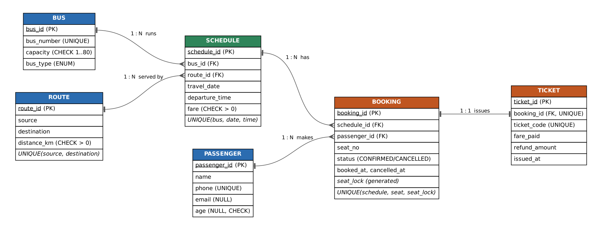

# DBMS Design Document

## 1. ER diagram


Entities: BUS, ROUTE, SCHEDULE, PASSENGER, BOOKING, TICKET. SCHEDULE is the associative entity that resolves the
many-to-many relation between BUS and ROUTE (a bus runs many routes over time, a route is served by many buses) and
carries the descriptive attributes *travel date, departure time, fare*. BOOKING resolves SCHEDULE × PASSENGER and
carries *seat number* and *status*. TICKET is 1:1 with BOOKING (the issued, priced document).

## 2. Relational schema
```
bus(bus_id PK, bus_number UNIQUE, capacity, bus_type)
route(route_id PK, source, destination, distance_km, UNIQUE(source,destination))
schedule(schedule_id PK, bus_id FK, route_id FK, travel_date, departure_time, fare, UNIQUE(bus_id,travel_date,departure_time))
passenger(passenger_id PK, name, phone UNIQUE, email NULL, age NULL)
booking(booking_id PK, schedule_id FK, passenger_id FK, seat_no, status, booked_at, cancelled_at NULL,
        seat_lock GENERATED, UNIQUE(schedule_id, seat_no, seat_lock))
ticket(ticket_id PK, booking_id FK UNIQUE, ticket_code UNIQUE, fare_paid, refund_amount, issued_at)
```

## 3. Functional dependencies and normalization
| Relation | Non-trivial FDs | Normal form |
|---|---|---|
| bus | bus_id → all; bus_number → all (candidate key) | BCNF |
| route | route_id → all; (source,destination) → route_id, distance_km | BCNF |
| schedule | schedule_id → all; (bus_id,travel_date,departure_time) → all | BCNF |
| passenger | passenger_id → all; phone → all | BCNF |
| booking | booking_id → all; (schedule_id, seat_no, seat_lock) → booking_id | BCNF |
| ticket | ticket_id → all; booking_id → all; ticket_code → all | BCNF |

Every determinant is a (candidate) key, so all relations are in BCNF (hence 3NF). Design decisions:
* Capacity lives only in `bus`, distance only in `route`, fare only per `schedule` – no repetition, no update anomalies.
* `fare_paid` is copied into `ticket` on purpose: the amount the passenger paid must not change if the schedule fare is
  edited later (a historical fact, not redundant data).
* No seat-count column is stored in `schedule`; availability is **derived** (`capacity − confirmed bookings`) so it can
  never go out of sync.
* Denormalization was not needed: reports use views over joins and run in milliseconds at this size.

## 4. Integrity constraints
| Kind | Examples |
|---|---|
| Domain / CHECK | capacity 1..80, distance > 0, fare > 0, age 1..110 or NULL, seat_no > 0, source ≠ destination |
| Entity / UNIQUE | bus_number, phone, ticket_code, (source,destination), (bus,date,time) |
| Referential | schedule→bus/route, booking→schedule/passenger, ticket→booking (no cascades: history is protected; deleting a referenced row is refused) |
| Business | trigger `trg_booking_capacity` (capacity), `trg_booking_cancel_time` (stamps cancel time, forbids re-activation) |

**Seat uniqueness trick.** `seat_lock` = `IF(status='CONFIRMED',1,NULL)`. A UNIQUE index on
`(schedule_id, seat_no, seat_lock)` rejects two *confirmed* bookings of one seat, but because NULLs never collide, any
number of *cancelled* rows for that seat may exist – so a freed seat can be sold again.

## 5. Views (reports)
| View | Purpose |
|---|---|
| `v_booking_report` | Ticket + passenger + journey + bus in one row |
| `v_route_revenue` | Tickets sold/cancelled, ticket revenue, cancellation fees, net revenue per route |
| `v_seat_occupancy` | Capacity, booked, available, occupancy % per schedule |

## 6. Indexing and query processing
InnoDB stores tables and indexes as B+ trees. Added: `idx_sched_route(route_id, travel_date)` for route/date searches and
revenue roll-ups, `idx_booking_sched(schedule_id, status)` for the availability count executed on every booking.
Primary/unique/foreign-key columns are indexed automatically.

## 7. Transactions and concurrency
* **Atomicity:** booking = `INSERT booking` + `INSERT ticket` in one transaction; any failure → `ROLLBACK`.
* **Consistency:** constraints + triggers hold at commit.
* **Isolation:** `SELECT … FOR UPDATE` on the schedule/bus row takes an exclusive row lock, so two clerks booking the
  same trip are serialised (a lock-based protocol, strict 2PL). Bookings on different trips do not block each other.
  All transactions lock in the same order (schedule → booking) so no deadlock cycle can form.
* **Durability:** InnoDB redo log.
* **Defence in depth:** even if the lock were bypassed, the trigger and the unique index would reject an over-booking
  (shown in `tests.sql`, T2/T3).
* **Verified:** 15 concurrent threads, 5 seats → exactly 5 commits.

## 8. Query catalogue
`database/queries.sql` contains 9 queries: aggregation with HAVING, joins, recursive CTE, sub-query, window function
(`RANK() OVER (PARTITION BY …)`), date functions, and an integrity audit. Output: `outputs/reports/sql_queries_output.txt`.
