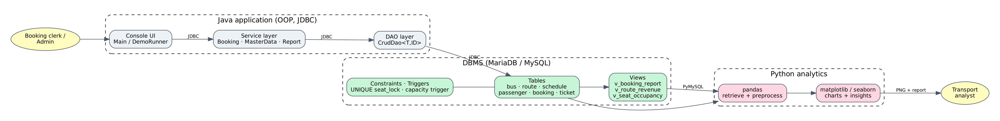
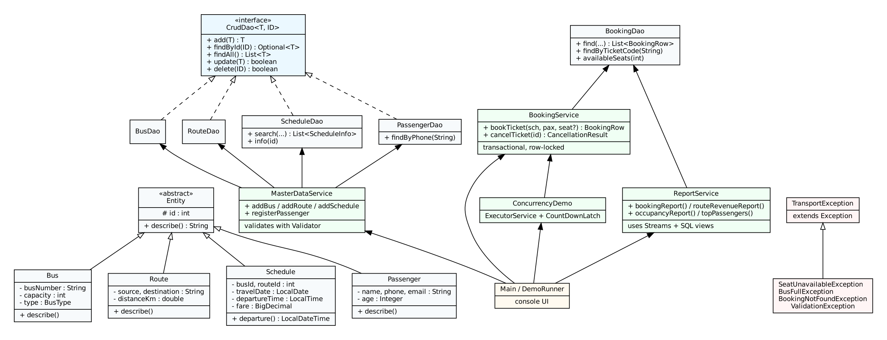

# Process, Design and Testing

## 1. Process model – Incremental (Agile-style) development
| Increment | Delivered | Verified by |
|---|---|---|
| 1 | Schema, constraints, sample data | Schema loads; `tests.sql` |
| 2 | Master data CRUD (FR1-FR4) | Demo steps 1-3 |
| 3 | Booking / cancellation + capacity control (FR5-FR7) | Demo steps 4-5, 7 |
| 4 | Reports (FR8) and Python analytics (FR9) | Demo step 6, `analysis_report.txt` |
Each increment was built, run against the real database and fixed before the next started (e.g. the first revenue
view ignored cancellation fees; this was found while checking report totals and the view was corrected).

## 2. Architecture


Layers: **UI** (`Main`, `DemoRunner`) → **Service** (business rules, transactions) → **DAO** (JDBC/SQL) → **Database**
(constraints, triggers, views). Python reads the same database through the views.

## 3. Class design


### Booking sequence (FR5)
```mermaid
sequenceDiagram
  participant C as Clerk (UI)
  participant S as BookingService
  participant D as MariaDB
  C->>S: bookTicket(schedule, passenger, seat?)
  S->>D: BEGIN; SELECT capacity, fare ... FOR UPDATE (locks trip)
  S->>D: SELECT seat_no of CONFIRMED bookings
  alt confirmed >= capacity
    S-->>C: BusFullException (ROLLBACK)
  else seat taken / invalid
    S-->>C: SeatUnavailableException (ROLLBACK)
  else
    S->>D: INSERT booking; INSERT ticket; COMMIT
    S-->>C: ticket (code, seat, fare)
  end
```

## 4. Test plan and results
Testing levels: DB-level (SQL), unit/functional via scripted Java demo, concurrency, system (Python pipeline).
All results below are from actual runs; raw outputs are in `outputs/reports/`.

| ID | Type | Test | Expected | Result |
|---|---|---|---|---|
| T1 | Black-box | Book seats 1 and 2 on a 2-seat bus | Both succeed, 0 free | **Pass** (db_tests T1) |
| T2 | Boundary | 3rd booking on full 2-seat bus | Rejected "Bus is full" | **Pass** |
| T3 | Boundary | Seat 7 on a 2-seat bus | Rejected | **Pass** |
| T4 | Functional | Cancel seat 2, re-book it | Seat freed, re-book OK | **Pass** |
| T5 | Negative | Re-activate cancelled booking | Rejected | **Pass** |
| T6 | Negative | Fare -5, duplicate route, age 150 | All rejected by constraints | **Pass** |
| J1 | Functional | Add bus `tn58-demo-0004`, route `"  madurai "`/`SALEM` | Normalised to upper-case / Title Case | **Pass** |
| J2 | Negative | Duplicate bus no., capacity 200, past schedule, phone `12345` | `ValidationException` each | **Pass** |
| J3 | Functional | Auto seat, chosen seat, 2nd seat for same passenger | Seats 1, 3, 2/4 allotted | **Pass** |
| J4 | Negative | Seat already booked / seat 9 of 4 | `SeatUnavailableException` | **Pass** |
| J5 | Boundary | 5th booking on 4-seat bus | `BusFullException` | **Pass** |
| J6 | Functional | Cancel 3 days ahead | 90 % refund = Rs. 270 of Rs. 300 | **Pass** |
| J7 | Negative | Cancel same ticket twice | Rejected | **Pass** |
| J8 | Concurrency | 15 threads race for 5 seats | Exactly 5 succeed, 10 `BusFullException`, DB shows 5 | **Pass** |
| J9 | Re-run | Demo run twice | Same data afterwards (5,800 bookings) | **Pass** |
| P1 | System | `analysis.py` end-to-end | 11 charts + report, totals equal SQL totals | **Pass** (Rs. 23,73,841 in Python = SQL after demo cleanup) |
| Q9 | Audit | Any schedule with booked > capacity | 0 rows | **Pass** |

Test techniques used: black-box (equivalence classes, boundary values for capacity/seat numbers), white-box
(branch coverage of `bookTicket`: not-found, departed, passenger-missing, full, preferred-invalid, preferred-taken,
auto-seat paths), and concurrency testing.

## 5. Estimation and project management
* **Size:** 1,814 non-blank lines (Java 1,422 · Python 247 · SQL 145) → 1.81 KLOC.
* **Basic COCOMO (organic):** Effort = 2.4 × (1.814)^1.05 = **4.5 person-months**; Time = 2.5 × E^0.38 = **4.4 months**;
  average staff ≈ 1.0 person.
* **Function-point view (unadjusted):** 9 external inputs, 6 external outputs (reports/ticket/exports), 3 inquiries,
  6 internal logical files, 0 external interface files.
  UFP = 9×4 + 6×5 + 3×4 + 6×10 = **138** (average weights).
* **Risk management**

| Risk | Prob. | Impact | Mitigation |
|---|---|---|---|
| Over-booking under concurrent users | Medium | High | Row lock, trigger, unique index; tested with 15 threads |
| Data-entry errors | High | Medium | Regex validation + DB CHECK constraints |
| DB unavailable at demo | Low | High | `run_all.sh`, README setup steps, seeded data |
| Report totals disagree with finance | Medium | Medium | Single source of truth (SQL views); Python totals cross-checked |

## 6. Requirements traceability
| Req | Code | Test |
|---|---|---|
| FR1 | `BusDao`, `MasterDataService.addBus` | J1, J2 |
| FR2 | `RouteDao`, `addRoute` | J1 |
| FR3 | `ScheduleDao.search`, `addSchedule` | J2 |
| FR4 | `PassengerDao`, `registerPassenger` | J2 |
| FR5 | `BookingService.bookTicket` | J3–J5, T1–T3, J8 |
| FR6 | `BookingService.cancelTicket` | J6, J7, T4, T5 |
| FR7 | `BookingDao.availableSeats`, trigger, unique index | J5, J8, T2, Q9 |
| FR8 | `ReportService`, 3 views | demo step 6, Q4, Q5 |
| FR9 | `CsvExporter`, `analysis.py` | P1 |
